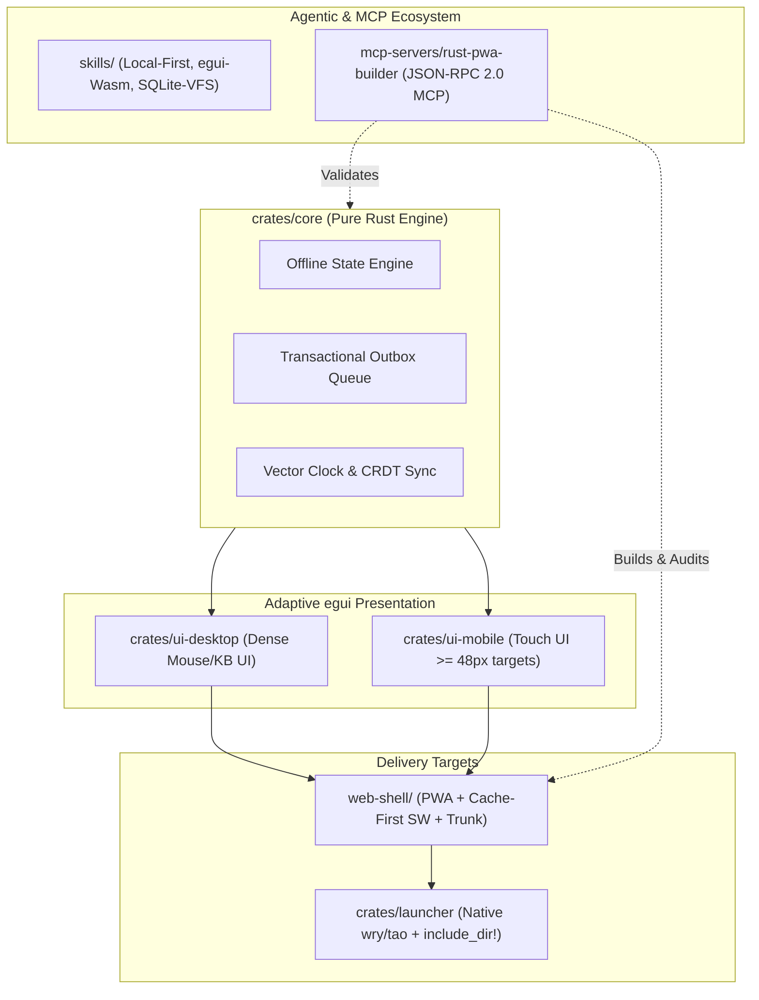

# ~ L@u’s Skill Labs (`~l@u` / `~l4u`)

> **Local-First Rust/Wasm PWA & Ultralight Native Desktop Architectures**

Welcome to **~ L@u’s Skill Labs**—an architectural research and engineering monorepo dedicated to building resilient, zero-latency **Local-First** applications powered by **Rust**, **WebAssembly (`wasm32-unknown-unknown`)**, **egui**, and **wry/tao**.

---

## 1. Architectural Vision

Modern software shouldn't fail when connectivity drops, nor should desktop applications ship hundreds of megabytes of bundled Chromium runtimes. **~ L@u’s Skill Labs** proves a unified architectural thesis:

1. **Strict Offline-First Core (`crates/core`)**: Pure Rust domain models, deterministic state machines, transactional Outbox queues, and conflict-free state synchronization with zero UI coupling.
2. **Adaptive Dual-Surface `egui` UI**:
   - **Desktop Surface (`crates/ui-desktop`)**: High-density, keyboard-driven, multi-panel workspace tailored for mouse precision and large displays.
   - **Mobile & Touch Surface (`crates/ui-mobile`)**: Ergonomic, responsive touch interface enforcing strict WCAG/Material `>= 48px` minimum hit targets and bottom-navigation ergonomics.
3. **Ultralight Native Desktop Wrapper (`crates/launcher`)**: A zero-bloat native desktop launcher built on `wry` and `tao` that embeds compiled Web/Wasm assets directly into the binary via `include_dir!`, served over a custom `laus://` protocol without external runtime dependencies.
4. **Progressive Web App Shell (`web-shell/`)**: Hardware-aware responsive bootstrapper that dynamically loads the appropriate Wasm bundle (`ui-desktop` vs `ui-mobile`) backed by an aggressive **Cache-First Service Worker (`sw.js`)**, IndexedDB/OPFS persistence, and standalone PWA manifest.
5. **Agentic Tooling & Skills (`skills/` & `mcp-servers/rust-pwa-builder`)**: Reusable AI engineering skills and a functional **Model Context Protocol (MCP)** server in Rust that automates Wasm builds and audits offline-readiness invariants.



---

## 2. Repository Structure

```text
laus-skill-labs/
├── Cargo.toml                         # Root Cargo Workspace definition
├── README.md                          # Project overview, architecture & attribution
├── GOALS.md                           # Short, medium, and long-term roadmap goals
├── TODO.md                            # Actionable engineering tasklist
├── CONTRIBUTING.md                    # Rust conventions, branch governance & commit rules
├── CHANGELOG.md                       # Keep a Changelog compliant release history
├── LICENSE                            # MIT License
├── crates/
│   ├── core/                          # Pure Rust offline state engine, outbox & models
│   ├── ui-desktop/                    # High-density egui desktop workspace
│   ├── ui-mobile/                     # Touch-first egui mobile interface (>= 48px targets)
│   └── launcher/                      # Native wry/tao wrapper embedding web-shell via include_dir!
├── guidelines/
│   ├── architecture.md                # Strict crate boundaries & dual-target compilation specs
│   ├── offline-cache-policy.md        # IndexedDB/OPFS storage matrix & Outbox pattern
│   └── launcher-spec.md               # Native wry/tao custom protocol & zero-runtime design
├── skills/
│   ├── rust-local-first/SKILL.md      # Skill: Local-first state machines & outbox sync in Rust
│   ├── egui-wasm-pwa/SKILL.md         # Skill: Dual-surface egui Wasm PWAs with Trunk
│   └── sqlite-wasm-vfs/SKILL.md       # Skill: SQLite over OPFS/IndexedDB VFS in wasm32
├── web-shell/
│   ├── index.html                     # Device-aware Wasm bundle loader & responsive shell
│   ├── manifest.json                  # Standalone PWA Web App Manifest
│   ├── sw.js                          # Cache-First Service Worker with offline fallback
│   └── Trunk.toml                     # Trunk Wasm build & asset pipeline configuration
└── mcp-servers/
    └── rust-pwa-builder/              # Rust MCP server for Wasm builds & offline readiness audits
```

---

## 3. Tech Stack

| Layer | Technology | Purpose |
| :--- | :--- | :--- |
| **Language** | Rust (2021 Edition) | Memory safety, zero-cost abstractions, shared native/Wasm codebase |
| **Core Serialization** | `serde`, `serde_json` | Deterministic state snapshots, Outbox payloads, and MCP JSON-RPC |
| **GUI Framework** | `egui` | Immediate-mode portable UI across native and `wasm32-unknown-unknown` |
| **Native WebView** | `wry`, `tao`, `include_dir` | Ultralight OS-native WebView wrapper with zero bundled browser bloat |
| **Web / PWA** | WebAssembly, Service Worker, OPFS/IndexedDB | Offline-first execution in browser and standalone installed PWA mode |
| **Build & Bundling** | Cargo Workspaces, Trunk | Multi-target compilation and automated Wasm asset pipelines |
| **Agentic Automation** | MCP (Model Context Protocol) | Automated Wasm target compilation and offline-readiness auditing |

---

## 4. Quick Start

### Verify Workspace & Run Tests
```bash
# Check all workspace crates (native target)
cargo check --workspace

# Verify WebAssembly compatibility for core and UI crates
cargo check -p laus-core -p laus-ui-desktop -p laus-ui-mobile --target wasm32-unknown-unknown

# Run unit and integration test suites
cargo test --workspace

# Enforce formatting and lint standards
cargo fmt --all -- --check
cargo clippy --workspace --all-targets -- -D warnings
```

### Run the MCP Server (`rust-pwa-builder`)
```bash
cargo run --manifest-path mcp-servers/rust-pwa-builder/Cargo.toml -- --help
```

---

## 5. Authorship, Credits & Total Transparency Policy

In strict adherence to our **Total Attribution Transparency Policy**, this repository openly documents both its human architectural leadership and the autonomous AI engineering agents that collaborated in co-designing and scaffolding the codebase:

- **Project Identity**: **~ L@u’s Skill Labs** (`~ L@u` / `~l@u` / `~l4u` / Tio Lau)
- **Lead & Architect**: **Laudivan Freire de Almeida** (`~ L@u` / **Uncle Lau**) — [@laudivan](https://github.com/laudivan)
  - *Role*: Vision, Local-First systems architecture, crate boundary specifications, governance model, and technical direction.
- **AI Collaborators**:
  - **Gemini** (*Architecture & Engineering Design*): Co-designed the Local-First state engine specifications, OPFS/IndexedDB persistence policies, adaptive `egui` ergonomics, and reusable engineering skill definitions.
  - **Antigravity** (*Autonomous Execution & Scaffolding*): Executed the end-to-end repository scaffolding, Cargo workspace implementation, Wasm/PWA shell integration, MCP builder server, verification suites, and Git branch governance workflow.

> *Built with craft and transparency by **Laudivan Freire de Almeida (~ L@u / Uncle Lau)** in collaboration with **Gemini** and **Antigravity**.*

---

## 6. License

Distributed under the **MIT License**. See [`LICENSE`](./LICENSE) for full details.
