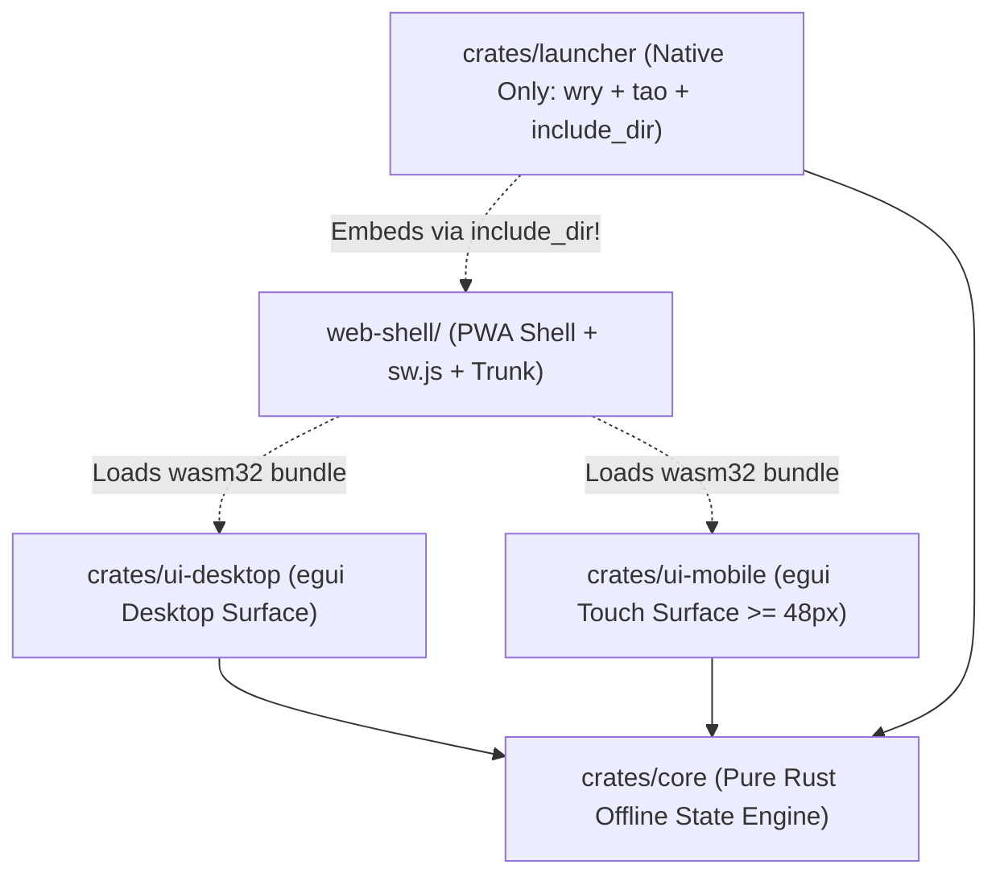

# Architecture Specification — ~ L@u’s Skill Labs (`~l@u` / `~l4u`)

## 1. Core Architectural Principles

**~ L@u’s Skill Labs** enforces a strict, compiler-verified boundary between **domain logic**, **adaptive presentation**, and **host runtime packaging**:

1. **Zero-I/O Domain Engine (`crates/core`)**:
   - Contains all business models, deterministic state transitions, Outbox mutation records, and conflict resolution policies.
   - Must compile unconditionally on both native targets (`x86_64`, `aarch64`) and WebAssembly (`wasm32-unknown-unknown`) without linking DOM, WebView, or OS windowing libraries.
2. **Form-Factor Specific `egui` Crates (`crates/ui-desktop` & `crates/ui-mobile`)**:
   - Rather than compromising desktop productivity with oversized mobile layouts or punishing touch users with cramped 18px desktop buttons, UI rendering is split into two specialized crates consuming `crates/core`:
     - `crates/ui-desktop`: Multi-column split views, dense data tables, keyboard-first command palettes, and hover tooltips.
     - `crates/ui-mobile`: Single-column cards, thumb-zone bottom navigation, and enforced `>= 48.0px` touch targets.
3. **Ultralight Native Host (`crates/launcher`)**:
   - Uses `wry` and `tao` to instantiate the operating system's native WebView (`WebKit` on macOS/iOS, `WebView2` on Windows, `WebKitGTK` on Linux/FreeBSD).
   - Embeds the compiled `web-shell/` directory directly into the Rust binary at compile time via `include_dir!`.

---

## 2. Dependency Direction & Crate Matrix

| Crate | Package Name | `wasm32-unknown-unknown` | Native (`aarch64` / `x86_64`) | Allowed Dependencies |
| :--- | :--- | :---: | :---: | :--- |
| `crates/core` | `laus-core` | Yes | Yes | `serde`, `serde_json`, `thiserror` |
| `crates/ui-desktop` | `laus-ui-desktop` | Yes | Yes | `laus-core`, `egui`, `serde` |
| `crates/ui-mobile` | `laus-ui-mobile` | Yes | Yes | `laus-core`, `egui`, `serde` |
| `crates/launcher` | `laus-launcher` | No (Host Bin) | Yes | `laus-core`, `include_dir`, `wry`, `tao` |

---

## 3. Target Compilation Strategy

### 3.1 WebAssembly (`wasm32-unknown-unknown`)
- Compiled via Cargo and bundled with `Trunk` (`web-shell/Trunk.toml`).
- `web-shell/index.html` evaluates hardware capabilities (`navigator.maxTouchPoints`, `window.matchMedia('(pointer: coarse)')`, and viewport width) prior to fetching the Wasm module, ensuring only the matching UI bundle (`laus-ui-desktop` or `laus-ui-mobile`) is instantiated.

### 3.2 Native Desktop (`laus-launcher`)
- Compiles to a single standalone executable with zero external runtime dependencies.
- Intercepts custom URI requests (`laus://localhost/...`) and serves embedded assets from memory with strict Content-Security-Policy (`CSP`) headers and MIME-type mapping (`.wasm` -> `application/wasm`).
