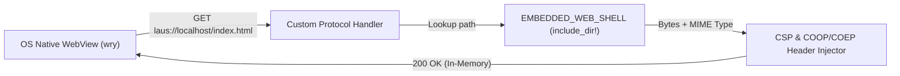

# Ultralight Native Desktop Launcher Spec — ~ L@u’s Skill Labs (`~l@u` / `~l4u`)

## 1. Design Goal: Zero External Runtime Bloat

Traditional cross-platform wrappers bundle an entire Chromium browser and Node.js runtime (`> 150 MB` disk footprint, `> 300 MB` idle RAM). **`crates/launcher` (`laus-launcher`)** eliminates third-party runtimes entirely by combining:

- **`tao`**: Cross-platform application window creation and event loop management in pure Rust.
- **`wry`**: Direct bindings to the operating system's built-in WebView engine (`WKWebView` on macOS, `WebView2` on Windows, `WebKitGTK` on Linux/FreeBSD).
- **`include_dir!`**: Compile-time embedding of the entire `web-shell/` directory directly into the Rust executable's read-only data segment.

---

## 2. Custom Protocol Architecture (`laus://`)

Instead of spawning a local TCP HTTP server (which exposes localhost ports and triggers OS firewall prompts), `laus-launcher` registers a custom URI scheme handler (`laus://localhost/<path>`):



### Required Security & Cross-Origin Isolation Headers
To enable SharedArrayBuffer and synchronous Origin Private File System (OPFS) access for `sqlite-wasm-vfs`, every response served by the `laus://` protocol handler includes:

```http
Cross-Origin-Opener-Policy: same-origin
Cross-Origin-Embedder-Policy: require-corp
Content-Security-Policy: default-src 'self' laus: 'unsafe-inline' 'wasm-unsafe-eval'; img-src 'self' data: blob:;
```

---

## 3. MIME Resolution Matrix

The embedded asset server maps file extensions deterministically:

| Extension | Content-Type Header | Notes |
| :--- | :--- | :--- |
| `.html` | `text/html; charset=utf-8` | Entry point (`index.html`) and fallback for SPA routes |
| `.js` / `.mjs` | `text/javascript; charset=utf-8` | Service Worker (`sw.js`) and `wasm-bindgen` glue |
| `.wasm` | `application/wasm` | Required for streaming WebAssembly compilation (`WebAssembly.instantiateStreaming`) |
| `.json` | `application/json; charset=utf-8` | `manifest.json` and configuration payloads |
| `.css` | `text/css; charset=utf-8` | Shell styling |
| `.svg` | `image/svg+xml` | Vector icons |

---

## 4. Headless & Diagnostic Verification Mode

To allow CI pipelines and autonomous agents (`mcp-servers/rust-pwa-builder`) to verify the embedded asset bundle on headless servers without an active GUI display server (`DISPLAY` / WindowServer), `laus-launcher` supports a `--verify-assets` / `--check` flag (and default verification fallback) that inspects all embedded files, validates MIME mappings, verifies `crates/core` offline engine health, and exits with status `0`.
