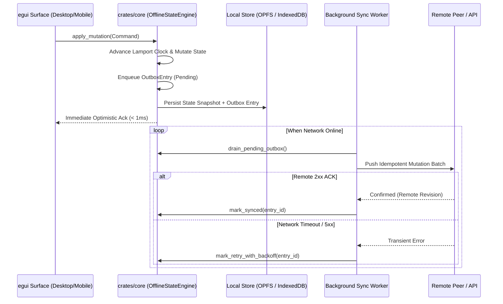

# Offline Cache Policy & Persistence Matrix — ~ L@u’s Skill Labs (`~l@u` / `~l4u`)

## 1. Local-First Invariant

In **~ L@u’s Skill Labs**, the network is treated as an **optional, asynchronous replication transport**—never a prerequisite for user interaction. Every read query is answered from local memory/storage (`< 1ms`), and every write mutation commits atomically to a local **Transactional Outbox** before returning control to the UI thread.

---

## 2. Local Persistence Matrix

Depending on the runtime environment and browser capabilities, storage layers are selected according to the following persistence hierarchy:

| Storage Tier | Primary Backing Store | Fallback Store | Target Data Class | Durability & eviction Policy |
| :--- | :--- | :--- | :--- | :--- |
| **Tier 0: Hot State** | Rust Heap (`OfflineStateEngine`) | N/A | Active UI view models, undo/redo stacks | Ephemeral per session; hydrated from Tier 1 on boot |
| **Tier 1: Structured DB** | **OPFS** (Origin Private File System) via `sqlite-wasm-vfs` | **IndexedDB** chunked page store | Domain entities, Outbox mutation log, Vector clocks | Persistent (`navigator.storage.persist()`); synchronous file access in Web Worker |
| **Tier 2: Static App Shell** | **Service Worker Cache Storage** (`laus-shell-v1`) | Browser HTTP disk cache | `index.html`, `sw.js`, `manifest.json`, `.wasm` binaries | **Cache-First**; updated atomically via versioned cache keys |
| **Tier 3: Native Embedded** | `include_dir!` static `.rodata` segment | OS application data directory | All `web-shell/` static assets inside `crates/launcher` | Immutable, zero-latency in-memory binary slice |

---

## 3. Transactional Outbox Pattern

Every state-mutating action produces both a deterministic local state transition and an immutable `OutboxEntry` within the same logical transaction:

### Outbox State Machine
1. `Pending`: Recorded locally, awaiting network transport.
2. `InFlight`: Picked up by the sync coordinator; locked with a monotonic attempt counter.
3. `Synced`: Acknowledged by remote peer; eligible for compaction/pruning.
4. `FailedRetryable`: Encountered a transient network error; scheduled with jittered exponential backoff:
   $$t_{\text{backoff}} = \min\left(t_{\max},\; t_{\text{base}} \cdot 2^{\text{attempts}}\right) + \text{jitter}$$
5. `ConflictResolved`: Deterministic LWW-Element-Set / Lamport clock tie-breaker applied automatically without blocking the user.

---

## 4. Service Worker Cache-First Lifecycle (`web-shell/sw.js`)

1. **Install Phase**: Pre-caches the critical boot shell (`index.html`, `manifest.json`, `sw.js`, and Wasm loader scripts) and calls `self.skipWaiting()`.
2. **Activate Phase**: Purges any stale cache buckets not matching the active `CACHE_VERSION` and claims all open clients via `self.clients.claim()`.
3. **Fetch Phase**:
   - **Static & Wasm Assets**: Served strictly **Cache-First**. If present in Cache Storage, responds immediately (`0ms` network wait); otherwise fetches, clones into cache, and returns.
   - **Navigation Requests**: Falls back to cached `/index.html` when offline so deep links always boot the PWA shell.
